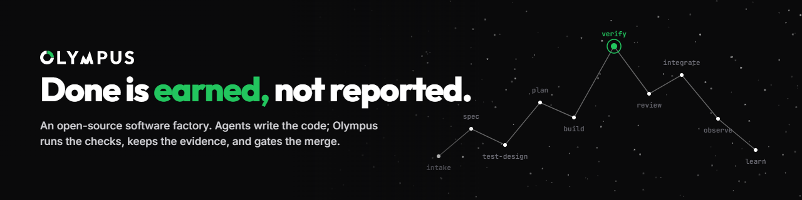

<p align="center"></p>

# Olympus

Olympus is a software factory runtime: a provider-neutral engine that carries
work from intent to merged code through a fixed line of stations, where policy
decides when work advances.

This is the v2 rewrite, on the `v2` branch. `main` is the frozen v1 line and
nothing here builds on it.

## Mission and claim

**Mission.** A fully autonomous software factory that defines, builds, and
ships working code.

**Claim, today.** Olympus produces auditable, tamper-resistant evidence that
autonomous work is real, so that a false-done failure is caught at the gate
rather than reported as done: the runtime derives what happened from checks it
ran itself, and a model's own account of its work is stored as a claim beside
the evidence, never as the verdict. That it *measurably reduces* false-done
failures is not asserted. Outcome measurement (R2) derives the rate from
finished runs, and the claim waits for that number from real runs.

The two are kept apart on purpose. The runtime is designed for the mission and
only the claim is asserted. Olympus does not claim lights-off autonomy. Every
autonomy level is capped by a policy file a human authors, an approval the
policy leaves unstated resolves to human-required, and the highest level is
not part of the first milestone.

## Open-source boundary

Everything in this repository is MIT licensed and stays MIT: the runtime, the
contracts, the drivers, the conformance kit, and the command line. See
[LICENSE](LICENSE).

The hosted control plane is a separate product in a separate repository.
Nothing in this repository depends on it, and no capability here is gated by
it.

## Status

**M1 is complete.** The line runs end to end, from `intake` through
`integrate`: real sandboxes, a locked Vault, the Claude Code driver, verified
evidence, tamper detection, cost bounds, an enforcement record, and a merge
that is gated by all of them. `observe` and `learn` are not entered yet.

**M2 is in progress.** Readiness (R1), outcome measurement (R2), model tier per
station (R14), acceptance checks on the base before build (R15), and security
at the gate (R17) have shipped. The current unit and everything after it are
listed in [docs/plan/DECOMPOSITION.md](docs/plan/DECOMPOSITION.md), which is
the source of truth for what is done and what is next.

## How the line works

Work moves through ten stations, in order:

| # | Station | What happens |
|---|---|---|
| 1 | `intake` | A trigger enters. The payload is data inside an envelope; it selects a pre-declared template and supplies parameters only. |
| 2 | `spec` | One shippable capability is written and locked. |
| 3 | `test-design` | A black-box acceptance oracle is written against the spec and locked. |
| 4 | `plan` | A task graph is emitted. |
| 5 | `build` | Tasks run in sandboxes. Agents write only to their workspace. |
| 6 | `verify` | The runtime runs the pinned checks in a fresh sandbox and collects evidence. |
| 7 | `review` | Reviewers that never share the author's model family. |
| 8 | `integrate` | Merge, gated by evidence and integrity. |
| 9 | `observe` | Post-merge signals. Not entered yet (R8). |
| 10 | `learn` | What the next run should do differently. Not entered yet (R11). |

Four autonomy levels bound how far a run may advance without a person:
`L0` manual, `L1` supervised, `L2` delegated, `L3` autonomous. The effective
cap is the tightest of the global cap, the station's cap, and the role's own
ceiling. Asking for more than policy allows is refused, never quietly
lowered.

Two places hold state. The **Vault** is the runtime-only store for everything
an agent must not be able to alter: locked specs and tests, policy, evidence,
violations, run state. The **Workspace** is the ephemeral, agent-writable
sandbox. The boundary between them is enforced where the sandbox is mounted,
not in application code.

## The invariants

Ten rules the whole design rests on. None may be violated to make a task
easier; a change that does is wrong regardless of what it enables. Each maps
to executable assertions in the [invariant registry](packages/conformance/src/registry),
and CI fails if any invariant has none.

| | Invariant | Registry |
|---|---|---|
| I1 | No agent writes to the Vault. Any level, any repo, any role. Enforced at the mount layer. | [i1.ts](packages/conformance/src/registry/i1.ts) |
| I2 | The runtime derives status; the model never reports it. `TaskResult` has no status field. | [i2.ts](packages/conformance/src/registry/i2.ts) |
| I3 | An agent may not be judged by an artifact it can write. Specs and acceptance tests are hashed before `build`. | [i3.ts](packages/conformance/src/registry/i3.ts) |
| I4 | Default deny. A capability not granted in policy is unavailable. | [i4.ts](packages/conformance/src/registry/i4.ts) |
| I5 | Fail closed. A missing check, missing capability, unsupported stack, or shrunken suite is a refusal, never a warning. | [i5.ts](packages/conformance/src/registry/i5.ts) |
| I6 | Reviewers never share the author's model family. The family is explicit, never inferred. | [i6.ts](packages/conformance/src/registry/i6.ts) |
| I7 | Event payloads are data, never instructions. Untrusted text never enters a prompt. | [i7.ts](packages/conformance/src/registry/i7.ts) |
| I8 | Every capability claim maps to an executable assertion that fails when the capability is deleted. | [i8.ts](packages/conformance/src/registry/i8.ts) |
| I9 | The runtime is a service; the CLI is a client. Nothing in `core` assumes a terminal. | [i9.ts](packages/conformance/src/registry/i9.ts) |
| I10 | Greek names never appear in code. Documentation and CLI output only. | [i10.ts](packages/conformance/src/registry/i10.ts) |

Run `pnpm conformance` to print the registry: which invariants are asserted,
partial, or pending, which unit owes each pending assertion, and how every
pending count compares with the committed baseline that CI ratchets it
against.

## Repository layout

```
packages/
  core/         runs, tasks, the driver contract, policy, stations
  vault/        locked artifacts, evidence bundles, run state
  integrity/    checks, results, tamper analysis, violations
  sandbox/      the mount table and the sandbox provider contract
  triggers/     the untrusted-input envelope
  adapters/     per-stack test, coverage, mutation, behavioral hooks
  readiness/    the autonomy ceiling a repository supports, from probes that ran
  compiler/     the roles a person wrote, compiled and versioned by hash
  api/          the runtime as a service: the line, the HTTP API, factory-host
  cli/          the command line, a client of the HTTP API and nothing more
  conformance/  the kit that proves invariants, and the registry
  drivers/
    claude-code/  the Claude Code CLI, run inside a provisioned sandbox
    openai-compatible/  any OpenAI-compatible chat endpoint; the loop on the host, every tool in the sandbox
docs/
  plan/         the spine, the decomposition into units, and unit specs
  decisions.md  every judgment call made while building each unit
  reviews/      external review findings and how each was resolved
```

Packages import each other only through their published entry, never through
a sibling's `src/`. `core` is the root of the graph.

## Getting started

Requires Node 22 or later, pnpm 12 (the `packageManager` field pins the
exact version), and a Docker daemon. Without Docker the suites fail rather
than skip: the Vault boundary is enforced where the sandbox is mounted, and
there is no way to observe that without a container.

```
pnpm install
pnpm typecheck     # every package, strict
pnpm lint          # one ESLint configuration for the whole workspace
pnpm test          # every package's tests
pnpm conformance   # the invariant registry and its report
```

CI runs these four on every push and pull request to `v2`, along with the
maintainer tooling's own typecheck and tests. On a pull request, the tests
that call a paid model run only once a maintainer applies the `run-driver`
label, and the registry fails until they have run for that tree. A push
reuses the report of an earlier run of the same tree.

## Run Olympus

The runtime runs as a service. The `factory-host` executable serves the HTTP
API and is configured only from its environment. The `olympus-ai` command
line is a client of that API and nothing more.

### Supported hosts

- **Linux or macOS**, with Node 22 or later, git, and a Docker daemon.
- **Windows: WSL2 (recommended).** Run the host inside a WSL2 distribution,
  with Docker reachable from it.
- **Windows, native: Developer Mode required.** A run's base is copied with
  its symbolic links kept as links, and native Windows lets a process create
  one only with Developer Mode on (Settings, System, For developers). The
  host checks this before it listens: it creates and removes one link under
  `FACTORY_TREES`, and refuses to start if that fails. Links are never
  emulated; a junction links only directories, and a link stored as a file
  would change the hash the locks are taken over.

### Install

Neither package is published to npm yet. From a checkout, build, pack, and
install both executables into an empty directory:

```
pnpm install
node scripts/local-release.ts ~/olympus
export PATH="$HOME/olympus/node_modules/.bin:$PATH"
```

This is the path CI tests: it installs the same tarballs npm would publish,
then starts `factory-host` and drives it with `olympus-ai`.

### Configure the host

`factory-host` reads these variables and no others. [.env.example](.env.example)
lists them with comments. A missing or invalid one stops the host before it
listens, and the host prints every problem in one list.

| Variable | Required | Secret | Purpose |
|---|---|---|---|
| `FACTORY_API_TOKEN` | yes | yes | The local token every request must bear, at least 32 characters. |
| `FACTORY_LISTEN_PORT` | yes | no | The port the API listens on. |
| `FACTORY_LISTEN_HOST` | no | no | The address the API listens on. Default `127.0.0.1`. |
| `FACTORY_POLICY_FILE` | yes | no | The `policy.yaml` every run is admitted under. |
| `FACTORY_ROLES_DIR` | yes | no | The roles directory seats are compiled from, outside the repository and the trees. |
| `FACTORY_RUBRICS_DIR` | no | no | The rubrics a drafting run's critics are given. Unset, a run that drafts is refused at admission. |
| `FACTORY_VAULT_STORE` | yes | no | The directory the Vault owns. |
| `FACTORY_REPOSITORY` | yes | no | The git working copy runs are admitted from. `create --workspace` names this path. |
| `FACTORY_TREES` | yes | no | Where each run's trees are kept. It must allow symbolic links. |
| `ANTHROPIC_API_KEY` | yes | yes | The model key, held by the host's relays and given to no sandbox. |
| `FACTORY_PRINCIPAL` | no | no | Who a request bearing the token is, as approvals record it. Default `local`. |
| `FACTORY_GIT_REPOSITORY` | yes | no | The GitHub repository a passed run merges into, as `owner/name`. |
| `FACTORY_GIT_BASE_BRANCH` | yes | no | The branch a passed run merges into. |
| `FACTORY_GIT_TOKEN` | yes | yes | The token that merges, held by the host and given to no sandbox. |
| `FACTORY_CONTAINER_UID` | no | no | The uid sandboxes run as. Both or neither with the gid; required on a host with no uids, such as native Windows. |
| `FACTORY_CONTAINER_GID` | no | no | The gid sandboxes run as. |
| `FACTORY_ENDPOINT_CONFIG` | no | no | A JSON file naming an OpenAI-compatible endpoint and the seats it fills. |
| `FACTORY_ENDPOINT_KEY` | no | yes | That endpoint's credential. Not set for an endpoint declaring scheme `none`. |
| `FACTORY_CODEX_SEATS` | no | no | The seats the Codex driver fills, comma-separated. Both or neither with its key. |
| `FACTORY_CODEX_KEY` | no | yes | The OpenAI key the Codex relay is given. |
| `FACTORY_CHECKS_TOKEN` | no | yes | Reads check runs, for runs with an observation window. Unset, such a run is refused when its window closes. |
| `FACTORY_WEBHOOK_*` | no | yes | Each webhook subscription's secret, by the full name the policy gives it. Unset, that subscription verifies no delivery. |

The command line needs only the API's address and token: `--url` and
`--token`, or `FACTORY_API_URL` and `FACTORY_API_TOKEN`.

## Contributing

Work is cut into units that a contributor can finish and verify alone, without
running the whole factory. [CONTRIBUTING.md](CONTRIBUTING.md) has the rule
every unit follows, the units that are open, and how to write a conformance
suite with the kit. The units themselves are defined in
[docs/plan](docs/plan): the spine, the decomposition, and a spec for each unit
that needs one. Decisions made while building each unit are recorded in
[docs/decisions.md](docs/decisions.md).

## License

MIT. See [LICENSE](LICENSE).
